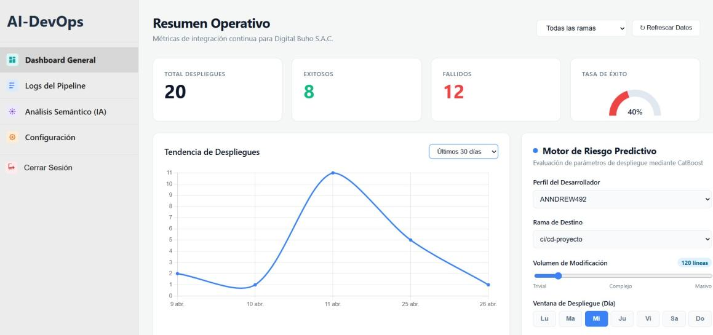
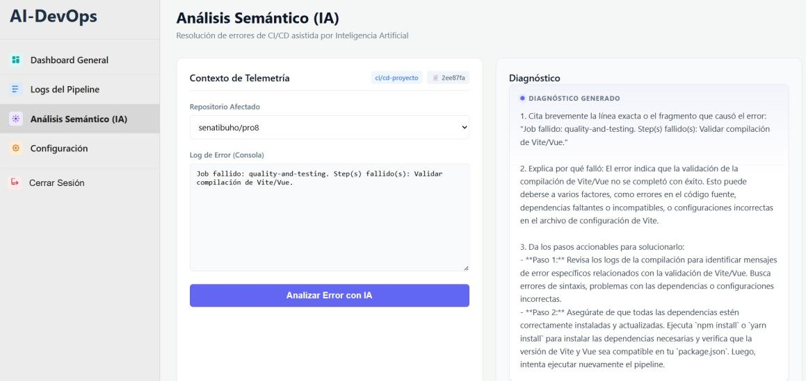
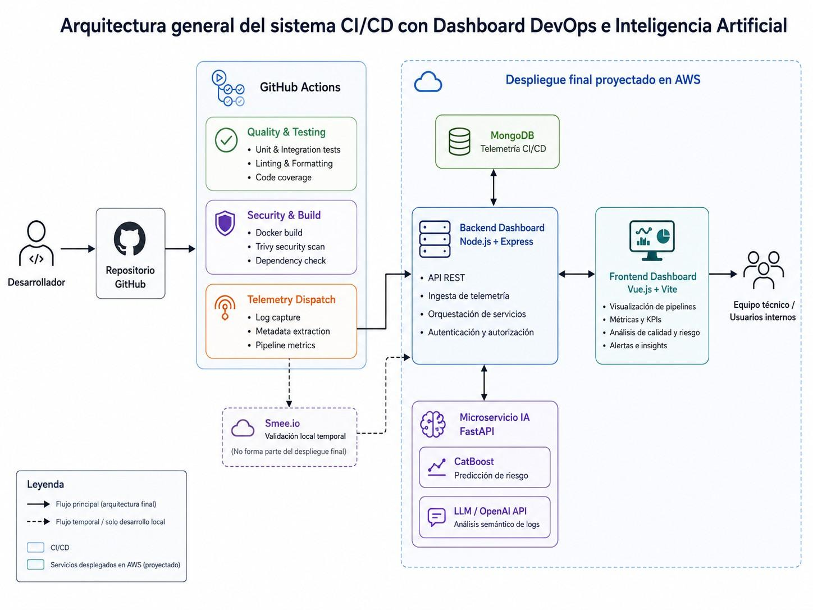
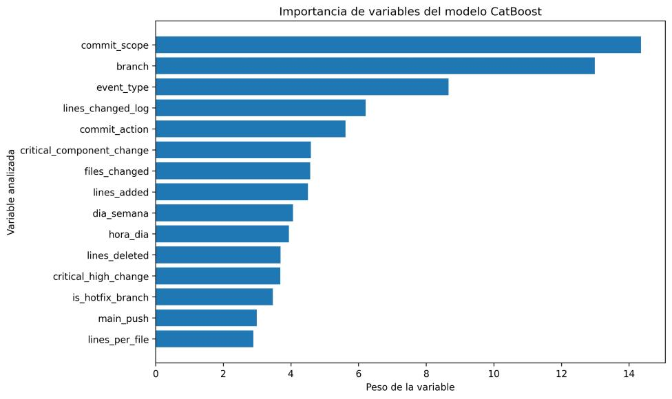
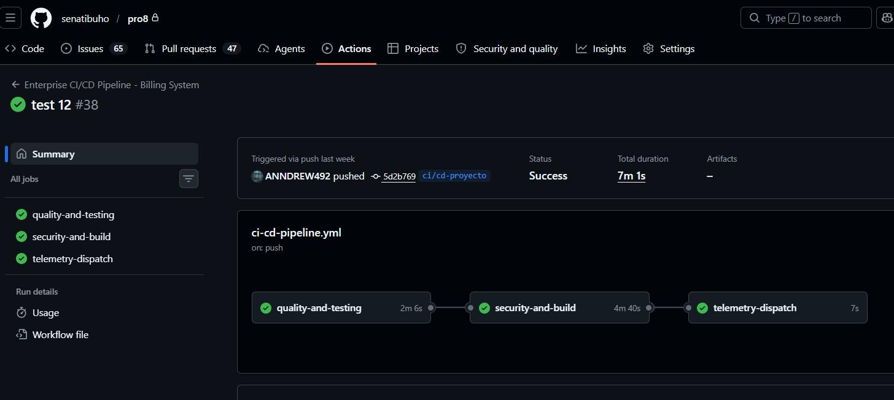
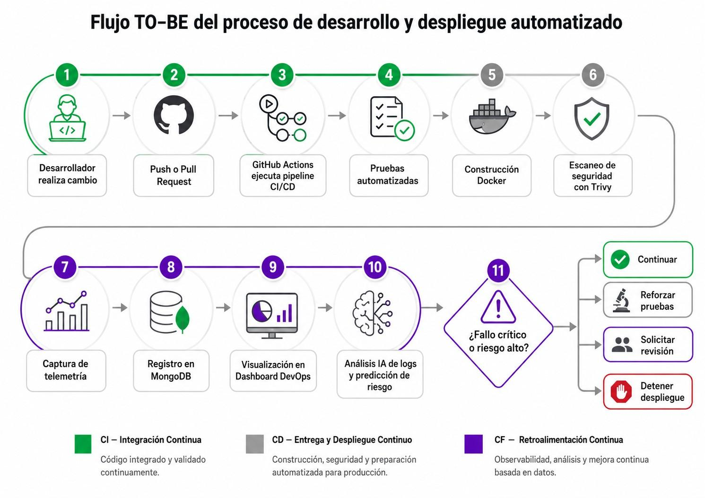
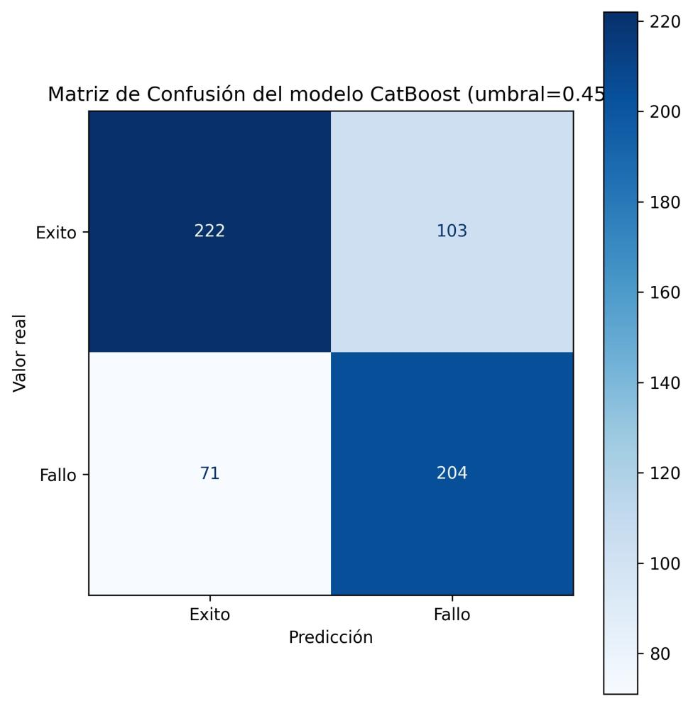
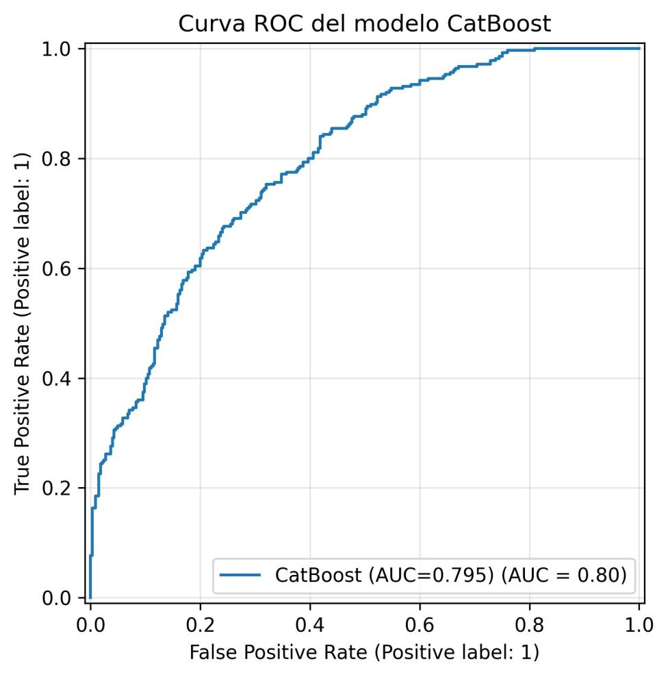

# AI-DevOps — CI/CD Observability & Predictive Risk Dashboard


Dashboard DevOps de **observabilidad CI/CD, predicción temprana de fallos y diagnóstico de logs asistido por IA**. Centraliza la telemetría de GitHub Actions, estima el nivel de riesgo de cada cambio con **CatBoost** antes de desplegar y explica errores de pipeline en segundos con **OpenAI**.

---

## Vista Previa

### Dashboard Operativo y Predictor de Riesgo (ML)
KPIs de despliegues en tiempo real, tendencias por rama y simulador interactivo conectado al modelo **CatBoost** (*en v3 el widget evalúa únicamente señales técnicas tempranas, sin evaluar personas*).



### Diagnóstico Semántico de Logs con IA
Interpreta errores reales del pipeline vía **OpenAI (`gpt-4o-mini`)** devolviendo la línea afectada, causa probable y pasos accionables de solución.



---

## Características Clave

- **Observabilidad Centralizada:** KPIs, tasa de éxito, historial de despliegues en MongoDB y vista detallada por ejecución.
- **Predicción Temprana de Riesgo (CatBoost):** Clasifica cada cambio como riesgo **Bajo / Medio / Alto** usando únicamente variables previas a la ejecución (rama, evento, alcance, volumen de cambios y horario), evitando *data leakage*.
- **Análisis Semántico de Logs (LLM):** Diagnóstico estructurado de fallos de compilación, pruebas o despliegue directamente desde la web.
- **Ciclo MLOps Automatizado:** Exportación de datasets desde MongoDB o CSV manual hacia **AWS S3**, reentrenamiento automático en **GitHub Actions** ([`retrain.yml`](.github/workflows/retrain.yml)) y cambio en caliente entre modelo local y modelo promovido en S3.
- **Seguridad:** Autenticación con **JWT** en dashboard/API y escaneo de vulnerabilidades con **Trivy** en el pipeline CI/CD.

---

## Arquitectura

Sistema desacoplado en 3 servicios (**Vue 3 + Vite**, **Node.js/Express** y **FastAPI/Python**), respaldado por **MongoDB** y **AWS S3**.



---

## Desempeño del Modelo Predictivo (CatBoost)

Calibrado con **umbral operativo `0.45`** para priorizar la detección temprana de despliegues riesgosos:

| AUC-ROC | Recall (fallo) | F1-Score (fallo) | Precision (fallo) | Accuracy |
| :---: | :---: | :---: | :---: | :---: |
| **0.7951** | **0.7418** | **0.7010** | **0.6645** | **71.00%** |



<details>
<summary><b>Ver más evidencia técnica (Pipeline CI/CD, Flujo Operativo y Gráficos de Evaluación ML)</b></summary>

<br />

#### Ejecución del Pipeline CI/CD en GitHub Actions


#### Flujo Automatizado CI / CD / Retroalimentación Continua


#### Matriz de Confusión y Curva ROC (CatBoost)
<table>
  <tr>
    <td align="center" width="50%">
      
      <br /><sub>Matriz de Confusión (umbral = 0.45)</sub>
    </td>
    <td align="center" width="50%">
      
      <br /><sub>Curva ROC (AUC = 0.795)</sub>
    </td>
  </tr>
</table>

</details>

---

## Stack Tecnológico

- **Frontend:** Vue 3, Vite, Vue Router, Chart.js, Apache ECharts
- **Backend:** Node.js, Express 5, Mongoose (MongoDB), JWT, AWS SDK
- **IA / ML:** Python 3.11+, FastAPI, CatBoost, Pandas, OpenAI API, Boto3
- **DevOps / MLOps:** GitHub Actions, Docker, Trivy, AWS S3, Smee.io (webhooks locales)

---

## Inicio Rápido

**Requisitos:** Node.js 18+, Python 3.11+, MongoDB Atlas y OpenAI API Key *(AWS S3 y `GH_PAT` son opcionales para reentrenamiento automático)*.

```bash
# 1. Clonar e instalar dependencias
git clone https://github.com/ANNDREW492/ci-cd-Dashboard-Ai-devops.git
cd ci-cd-Dashboard-Ai-devops
npm install && (cd backend-api && npm install)

# 2. Crear entorno Python para el microservicio de IA
cd ai-service && python -m venv venv
.\venv\Scripts\Activate.ps1   # Linux/macOS: source venv/bin/activate
pip install fastapi uvicorn python-dotenv openai pydantic pandas catboost boto3
cd ..

# 3. Configurar variables de entorno usando .env.example como plantilla
#    -> .env.local | backend-api/.env | ai-service/.env

# 4. Levantar Frontend (:5173), Backend (:3000), IA (:8000/docs) y Webhook Smee
npm run dev:all
```

> **Credenciales demo (desarrollo local):** `admin@example.com` / `admin123` · `developer@example.com` / `dev123`.
> Los binarios `.cbm` están ignorados por Git: coloca `catboost_despliegues_v3.cbm` en `ai-service/` o activa `MODEL_SOURCE=s3`.

---


